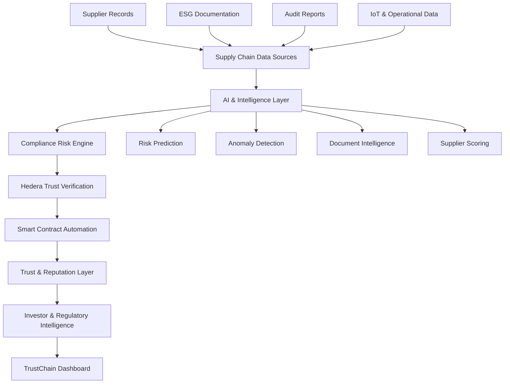

# 🚀 Hedera TrustChain
### AI + Blockchain-Powered Supply Chain Compliance & Decentralized Trust Intelligence

**Predict Risk. Verify Trust. Automate Compliance.**

Hedera TrustChain is a next-generation supply chain compliance intelligence platform combining Artificial Intelligence (AI), Machine Learning (ML), and Hedera Distributed Ledger Technology (DLT) to transform how organizations assess supplier risk, verify ethical sourcing, manage regulatory compliance, and establish institutional trust.

The platform moves beyond traditional supply chain tracking by introducing predictive compliance intelligence, blockchain-backed auditability, automated verification workflows, and incentive mechanisms for responsible business practices.

> **Our vision:** Build an intelligent trust infrastructure where supply chain transparency becomes verifiable, compliance becomes proactive, and ethical business practices create measurable economic value.

---

## 🌍 1. The Vision: From Supply Chain Tracking to Trust Infrastructure

Traditional supply chain systems are often fragmented, reactive, and dependent on centralized reporting.

Organizations struggle with:
- Limited visibility into multi-tier supplier networks.
- Fraudulent or unverifiable compliance documentation.
- Delayed identification of environmental and human-rights risks.
- Increasing ESG and regulatory reporting requirements.
- Expensive and repetitive supplier due diligence.
- Limited trust between suppliers, businesses, regulators, and investors.

Hedera TrustChain addresses these challenges through an integrated intelligence and verification infrastructure.

### Zero-to-One Innovation

Rather than building another supplier tracking application, TrustChain introduces five interconnected capabilities:

| Innovation | Capability |
|---|---|
| Predictive Compliance AI | Identifies emerging supplier risks before potential violations escalate. |
| Decentralized Trust Verification | Anchors verifiable compliance evidence to Hedera. |
| Autonomous Compliance Workflows | Coordinates alerts, reviews, and policy enforcement. |
| Tokenized Incentives | Explores rewards for independently verified responsible practices. |
| Capital Market Integration | Makes trustworthy supply chain intelligence accessible to investors. |

---

## 🧠 2. Platform Architecture

TrustChain is designed around five interconnected intelligence layers.

### Core Technology Layers

**1. Data Intelligence Layer**
- Supplier information and organizational profiles.
- Environmental, Social, and Governance (ESG) documentation.
- Compliance certificates and audit records.
- Supply chain transactions and operational data.
- External regulatory and risk intelligence.

**2. AI Intelligence Layer**
- Predictive risk assessment.
- Anomaly and fraud detection.
- Supplier performance analysis.
- Natural language document processing.
- Compliance recommendations.
- Explainable AI-generated insights.

**3. Hedera Verification Layer**
- Hedera Consensus Service (HCS) for timestamped, ordered verification events.
- Hedera Token Service (HTS) for digital trust incentive mechanisms.
- Hedera Smart Contract Service for programmable compliance workflows.
- Cryptographic hashes and references to supporting evidence.
- Verifiable audit trails.

**4. Automation Layer**
- Risk-triggered notifications.
- Compliance review workflows.
- Smart contract conditions.
- Supplier verification requests.
- Regulatory reporting assistance.

**5. Intelligence Presentation Layer**
- Executive dashboards.
- Supplier scorecards.
- Global risk visualization.
- Investor intelligence.
- Regulatory compliance reporting.

---

## 📊 3. Dashboard Modules

### 01. Real-Time Compliance Intelligence

**Your Supply Chain at a Glance**

A centralized operational command center providing an overview of supplier performance, compliance exposure, and verification activity.

Key features:
- Global compliance overview.
- Supplier risk distribution map.
- Live compliance notifications.
- Verification activity monitoring.
- Regulatory deadlines.
- ESG performance indicators.
- Executive reporting.

**Illustrative dashboard metrics:**

| Metric | Example |
|---|---:|
| Global Compliance Score | 87% |
| High-Risk Suppliers | 3 |
| Verified Suppliers | 124 |
| Pending Audits | 12 |
| Blockchain Audit Events | 1,842 |

*Illustrative demonstration values, not live verified production data.*

### 02. AI-Powered Supplier Risk Analysis

**Predict and Prevent Non-Compliance**

An intelligence engine that evaluates supplier information and identifies potential compliance vulnerabilities.

Supplier risk dimensions:

- Human rights and labor practices.
- Environmental performance.
- Financial and operational integrity.
- Ethical sourcing.
- Documentation authenticity.
- Regulatory compliance.

**Supplier Trust Classification:**

| Classification | Risk Level |
|---|---|
| Trusted | Low |
| Monitored | Moderate |
| Elevated Risk | High |
| Critical | Severe |

AI capabilities:
- Predictive risk modeling.
- Supplier anomaly detection.
- Compliance trend forecasting.
- Automated document analysis.
- Explainable risk recommendations.

Example intelligence alerts:

- Potential increase in ESG violations across a monitored supplier network.
- Supplier trust score declining following new audit evidence.
- Sustainable sourcing targets at risk of non-attainment.

Predictions are advisory signals requiring evidence-based validation and human review.

### 03. Hedera Blockchain Trust Verification

**Decentralized Compliance Reputation**

TrustChain uses Hedera to create independently verifiable records of compliance-related events.

Core functionality:
- Tamper-evident audit records.
- Supplier verification history.
- Cryptographic evidence references.
- Timestamped compliance events.
- Smart contract-based workflow conditions.
- Supplier reputation history.

**Proposed verification workflow:**

1. Supplier submits compliance documentation.
2. AI extracts and analyzes relevant information.
3. Authorized reviewers validate supporting evidence.
4. A verification event is cryptographically anchored to Hedera.
5. The supplier's trust profile is updated.
6. Authorized stakeholders can independently verify the recorded event.

**Trust Score Components:**

- Environmental compliance.
- Social responsibility.
- Governance standards.
- Audit history.
- Documentation integrity.
- Corrective action performance.

The trust score is an application-level assessment, not a score natively issued by Hedera.

### 04. Capital Market & ESG Intelligence

**Verified Information for Better Investment Decisions**

A dedicated intelligence environment for institutional investors, financial institutions, and ESG analysts.

Features:
- Supplier risk exposure analysis.
- Verified compliance evidence.
- ESG performance monitoring.
- Investment due diligence support.
- Supply chain risk reporting.
- Portfolio-level sustainability intelligence.

Potential applications:
- Institutional investment screening.
- Sustainable procurement finance.
- ESG risk evaluation.
- Responsible supply chain financing.
- Corporate governance analysis.

### 05. Tokenized Incentives for Ethical Supply Chains

**Rewarding Verifiable Responsibility**

TrustChain explores an incentive mechanism using the Hedera Token Service (HTS).

Proposed functionality:
- Recognition of independently verified supplier achievements.
- Digital reputation credentials.
- Incentive distribution based on defined compliance milestones.
- Supplier participation and engagement.
- Transparent incentive histories.

Potential incentive mechanisms:
- Verified sustainability milestones.
- Improved labor standards.
- Successful corrective action completion.
- Environmental performance improvements.
- Consistent audit compliance.

**Important:** Token rewards are proposed functionality. They require carefully designed governance, eligibility rules, regulatory review, and protection against manipulation. Compliance scores should not automatically trigger punitive blacklisting without due process.

---

## 👥 4. Role-Based Access Control

TrustChain supports different stakeholder environments.

| User Role | Capabilities |
|---|---|
| Business Owners | Monitor organizational compliance and supplier networks. |
| Suppliers | Submit evidence and manage verification profiles. |
| Regulators | Review authorized compliance records and audit histories. |
| Investors | Access verified ESG and supply chain intelligence. |
| Auditors | Validate evidence and issue review outcomes. |
| Administrators | Configure permissions, policies, and workflows. |

Access is governed by role-based permissions and evidence confidentiality requirements.

---

## 🎨 5. UX/UI Design Philosophy

TrustChain combines enterprise-grade usability with a futuristic intelligence interface.

**Visual Direction**
- Dark and light dashboard themes.
- Glassmorphism-inspired interface elements.
- Clean typography and structured information hierarchy.
- High-contrast compliance indicators.
- Interactive charts and geographic visualizations.
- Responsive dashboard layouts.

**Interaction Design**
- Real-time alert states.
- Interactive supplier scorecards.
- Expandable compliance reports.
- Animated data transitions.
- Customizable dashboard widgets.
- Contextual tooltips and evidence panels.

The objective is to make complex compliance intelligence understandable, actionable, and auditable.

---

## ⚙️ 6. Proposed Technology Stack

| Layer | Technology |
|---|---|
| Frontend | React, TypeScript |
| Build Tool | Vite |
| Styling | Tailwind CSS |
| UI Components | shadcn/ui |
| Icons | Lucide React |
| Animation | Framer Motion |
| Data Visualization | Recharts |
| Backend | Node.js / Supabase |
| Database | PostgreSQL |
| AI/ML | Python, Scikit-learn, LLM APIs |
| Blockchain | Hedera Hashgraph |
| Consensus & Audit Events | Hedera Consensus Service |
| Digital Incentives | Hedera Token Service |
| Smart Contracts | Solidity / Hedera Smart Contract Service |
| Authentication | Supabase Auth |
| Deployment | Vercel |

*This is the proposed architecture. Actual technologies should be aligned with the implemented repository.*

---

## 🔐 7. Security, Privacy & Governance

TrustChain is designed around responsible data management and verifiable accountability.

Security considerations:
- Role-based access control.
- Secure authentication.
- Encryption in transit and at rest.
- Evidence integrity verification.
- API authentication and authorization.
- Audit logging.
- Data minimization.
- Controlled disclosure of supplier information.

**On-chain vs. Off-chain Architecture**

Sensitive business information, personal data, and full compliance documents should generally remain in appropriately secured off-chain storage.

Hedera can store:
- Cryptographic evidence hashes.
- Verification event identifiers.
- Timestamps.
- Transaction references.
- Approved public verification metadata.

This approach supports verifiability without unnecessarily exposing confidential information.

---

## 🗺️ 8. Development Roadmap

### Phase 1: Intelligence Dashboard
- [ ] Dashboard interface.
- [ ] Executive compliance overview.
- [ ] Supplier management.
- [ ] Risk scorecards.
- [ ] Interactive visualizations.
- [ ] Demonstration datasets.

### Phase 2: AI Compliance Engine
- [ ] Supplier risk classification.
- [ ] Document intelligence.
- [ ] Anomaly detection.
- [ ] Predictive risk modeling.
- [ ] Explainable AI recommendations.
- [ ] Alert management.

### Phase 3: Hedera Integration
- [ ] Hedera account integration.
- [ ] Consensus Service integration.
- [ ] Evidence hash anchoring.
- [ ] Blockchain verification interface.
- [ ] Supplier audit history.
- [ ] Transaction verification.

### Phase 4: Smart Contracts & Trust Incentives
- [ ] Smart contract workflows.
- [ ] HTS token experimentation.
- [ ] Supplier reputation mechanisms.
- [ ] Verification-based incentives.
- [ ] Governance and permissions.

### Phase 5: Institutional Intelligence
- [ ] Investor dashboard.
- [ ] ESG intelligence reports.
- [ ] Regulatory reporting workflows.
- [ ] Multi-organization support.
- [ ] Enterprise integrations.

---

## 🌐 9. Real-World Applications

TrustChain can be adapted to several industries:

| Industry | Application |
|---|---|
| Agriculture | Ethical sourcing and farm-level traceability. |
| Manufacturing | Supplier verification and industrial compliance. |
| Mining | Environmental and human-rights monitoring. |
| Logistics | Shipment provenance and operational integrity. |
| Pharmaceuticals | Product provenance and authorized supply chain verification. |
| Energy | Sustainability reporting and supplier due diligence. |
| Financial Services | ESG risk intelligence and investment screening. |

### Example: Agricultural Supply Chain

Consider an agricultural exporter sourcing products from multiple farms.

TrustChain could:

1. Register participating farms and suppliers.
2. Collect sustainability and labor documentation.
3. Analyze supplier risk using AI.
4. Verify submitted evidence through authorized review.
5. Anchor verification events on Hedera.
6. Generate traceable compliance reports.
7. Provide buyers and investors with authorized access to verification records.

The result is a more transparent relationship between producers, exporters, buyers, and financial institutions.

---

## 💡 10. The Bigger Opportunity

Hedera TrustChain explores a broader technological opportunity: **the infrastructure of verifiable business trust.**

Today, supply chains move products, services, information, and capital across organizational boundaries.

Tomorrow, they will increasingly need to move something equally important: independently verifiable evidence of responsibility.

TrustChain aims to connect:

- Artificial intelligence for predictive intelligence.
- Blockchain for decentralized verification.
- Smart contracts for programmable workflows.
- Tokenization for responsible incentives.
- ESG intelligence for institutional decision-making.

The long-term vision is an interoperable trust layer that helps organizations make better decisions across global supply networks.

---

## 🤝 11. Contributing

Contributions, technical feedback, research collaborations, and ecosystem partnerships are welcome.

Potential contribution areas:
- AI and machine learning.
- Hedera ecosystem development.
- Smart contract engineering.
- Supply chain intelligence.
- ESG data and verification.
- Enterprise dashboard development.
- Security and governance.

To contribute:

1. Fork the repository.
2. Create a feature branch.
3. Implement and test your changes.
4. Submit a pull request with a description of your contribution.

---

## 📜 12. License

Add the appropriate open-source license when the repository's licensing terms have been established.

---

## 🚀 Final Vision

**Hedera TrustChain | Intelligence. Integrity. Trust.**

We envision a world where compliance is not simply documented, but continuously evaluated; where trust is not merely claimed, but independently verifiable; and where responsible business practices become an advantage in the global economy.

**Build the infrastructure of trust.**
